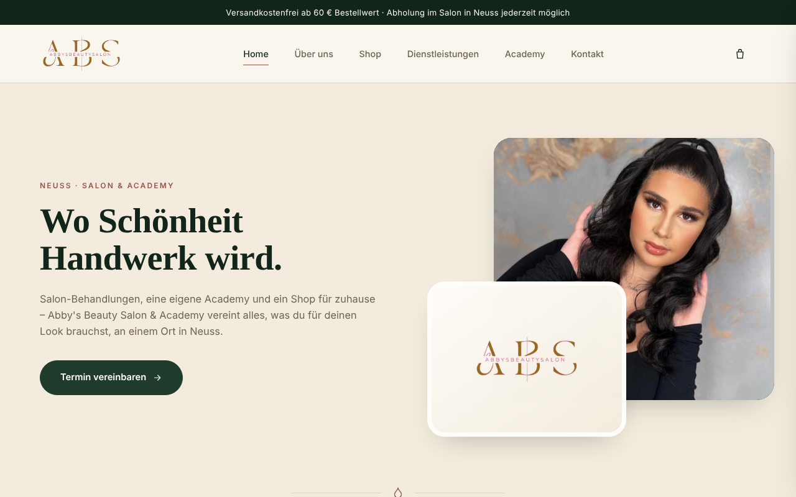
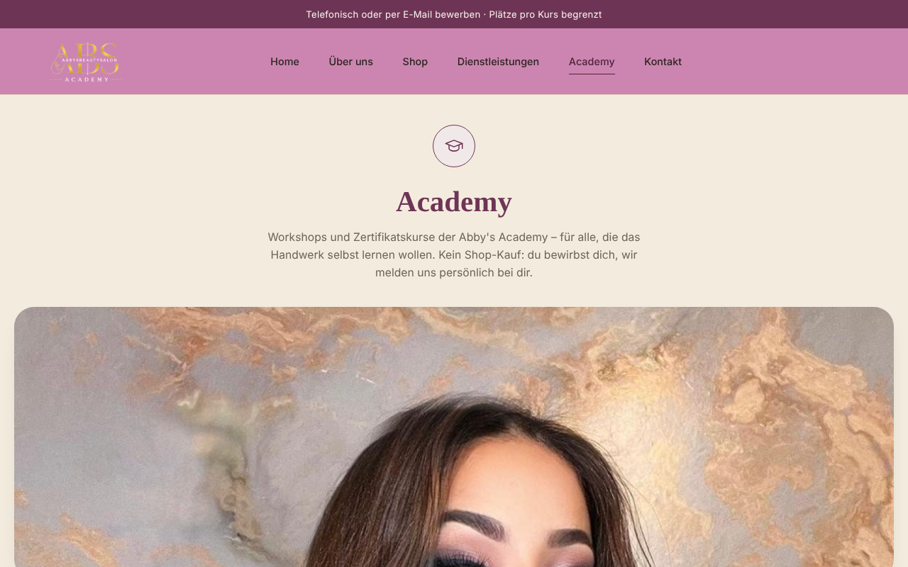
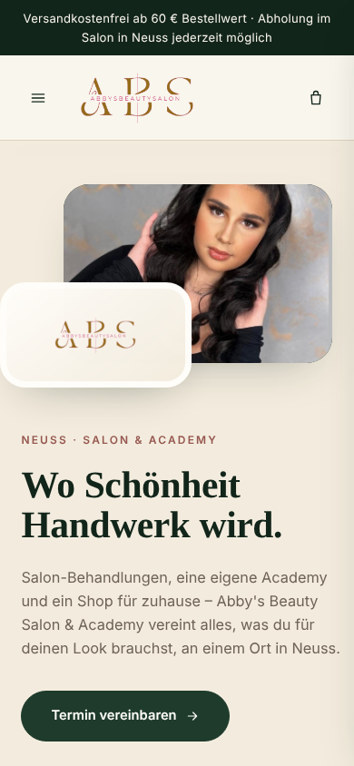

# Abby's Beauty Salon & Academy: Website

Website für einen Beauty-Salon mit eigener Academy in Neuss. Entstanden in meinem 8-wöchigen Schülerpraktikum 2026, direkt im Salon.



## Was die Seite kann

* **15 Seiten:** Start, Über uns, Dienstleistungen, Academy, Kontakt, Impressum, Shop mit Kategorien und Produktseiten
* **Shop mit Warenkorb:** eigene JavaScript-Engine (`shop-cart.js`), die von allen Shop-Seiten genutzt wird
* **Academy-Bereich:** Kurse nur auf Anfrage, mit Bewerbungsformular statt Preisen
* **Responsive:** funktioniert auf Handy, Tablet und Desktop
* **Eigenes Design-System:** ein gemeinsames Stylesheet für alle Seiten (Waldgrün und Rosé, Cormorant Garamond und Inter)

## Technik

* HTML, CSS und JavaScript ohne Framework

```
index.html, ueber-uns.html, ...   Seiten
shop-style.css                    gemeinsames Design für alle Seiten
shop-cart.js                      Warenkorb und Produktanzeige
bilder/                           Fotos und Logos
```

## Screenshots

| Academy | Mobil |
|---|---|
|  |  |

## Meine Aufgaben

* Seitenstruktur und Navigation geplant (vom Einseiter zur vollen Website)
* Design umgesetzt und mit der Inhaberin abgestimmt
* Texte, Fotos und Logos eingebaut, Logos freigestellt
* Warenkorb in JavaScript geschrieben
